# Adaptive Finite Elements for a Linear Parabolic Problem

**Numerical Methods for Partial Differential Equations** — A.Y. 2025/2026, Politecnico di Milano
Prof. Alfio Quarteroni — Dr. Michele Bucelli

**Authors:**
Alessandro Russi, Francesco Maria Reggio, and Seyed Vahid Ghayoomie

A deal.II / MPI / Trilinos solver for the heat equation with a pulsed, localized forcing term,
combining space (`h`) and time (`k`) adaptivity driven by an *a posteriori* error estimator
(Picasso, 1998), with a non-adaptive baseline for comparison.

- **Full report:** [`docs/report.pdf`](docs/report.pdf) — mathematical formulation, discretization, implementation, and all numerical results below in full detail.
- **Interactive notebook:** [`scripts/notebook.ipynb`](scripts/notebook.ipynb) — every figure below, reproducible from the solver's own `.vtu`/`.csv` output, plus a `pyvista`-based ParaView-style visualization and a pulse animation GIF.

## Results at a glance

**Both adaptive mechanisms are active and doing what they're designed to do.** $\Delta t$ grows
geometrically through quiet periods and drops sharply near each pulse; $\Delta x$ concentrates
resolution around the source and stays there.

<p align="center">
  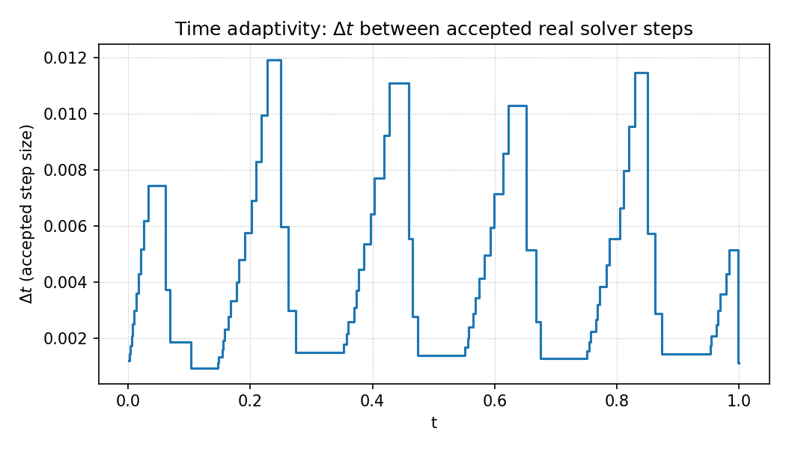
  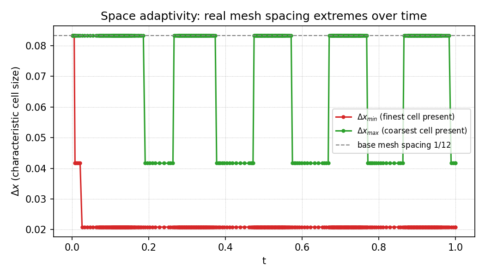
</p>

**Adaptive vs. non-adaptive:** peak solution *values* are nearly identical (0.8% apart), but the
resolved *gradient* is not — adaptive resolves gradients 3.5–6$\times$ higher than the non-adaptive
baseline, on 645,616 vertices concentrated near the source vs. a fixed, uniform 13,824.

<p align="center">
  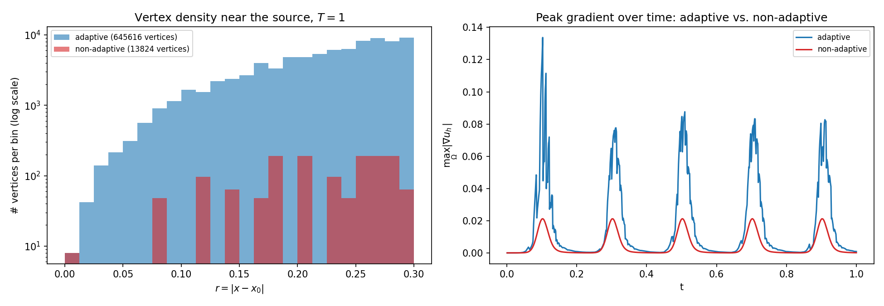
</p>

**Real (solver) vs. constructed (analytic) data**, checked across space, time, and both together
as a genuine 3D surface — this comparison caught a real bug (a fixed 3-point-quadrature time
indicator could miss a narrow pulse once $\Delta t$ grew too wide), fixed by capping `dt_max` to
the pulse's own width:

<p align="center">
  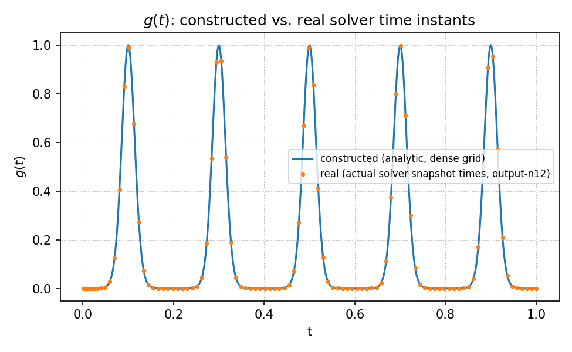
  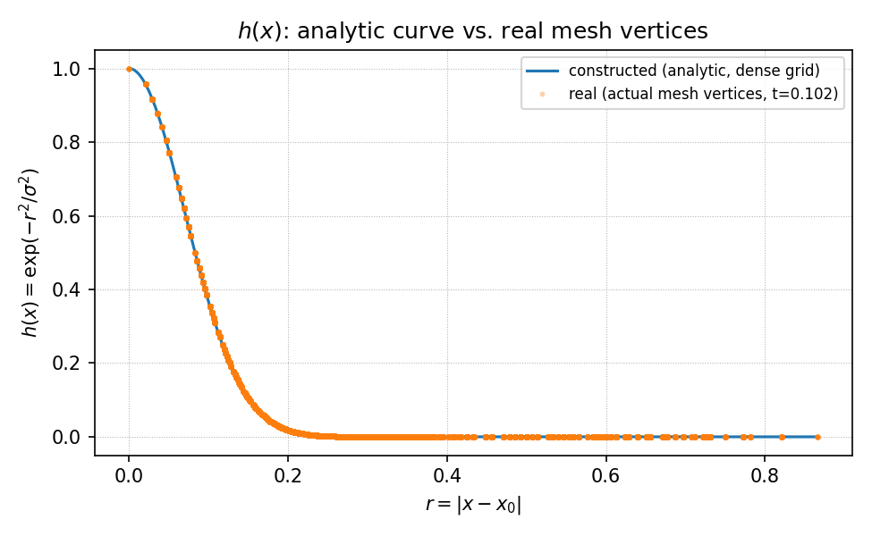
  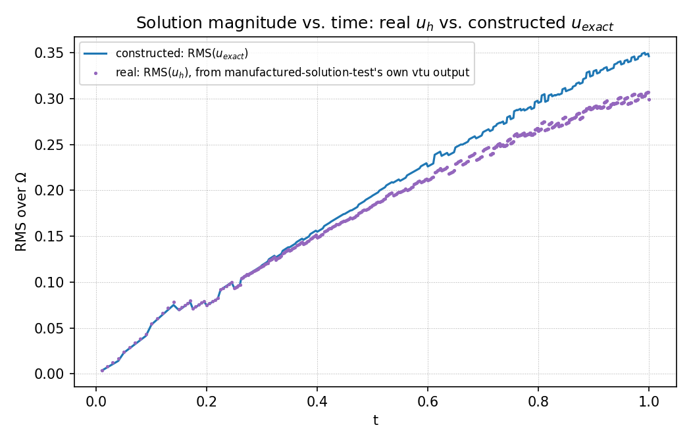
</p>
<p align="center">
  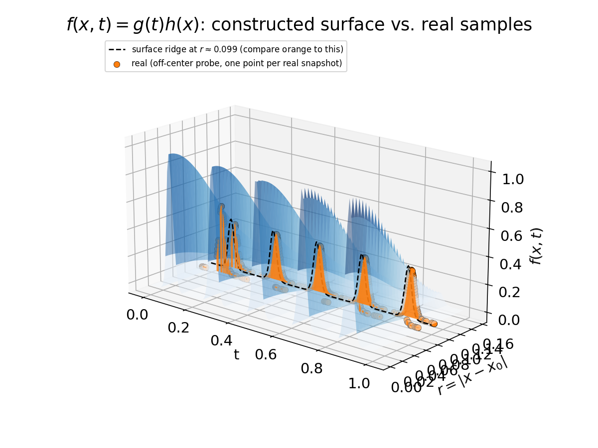
</p>

**Convergence study** ($N_{el}\in\{3,6,9\}$ against a $N_{el}=12$ reference — the mesh sizes chosen
after two larger sweeps were OOM-killed by the container's memory ceiling), in the same style as
the course's own `plot-convergence.py` scripts:

<p align="center">
  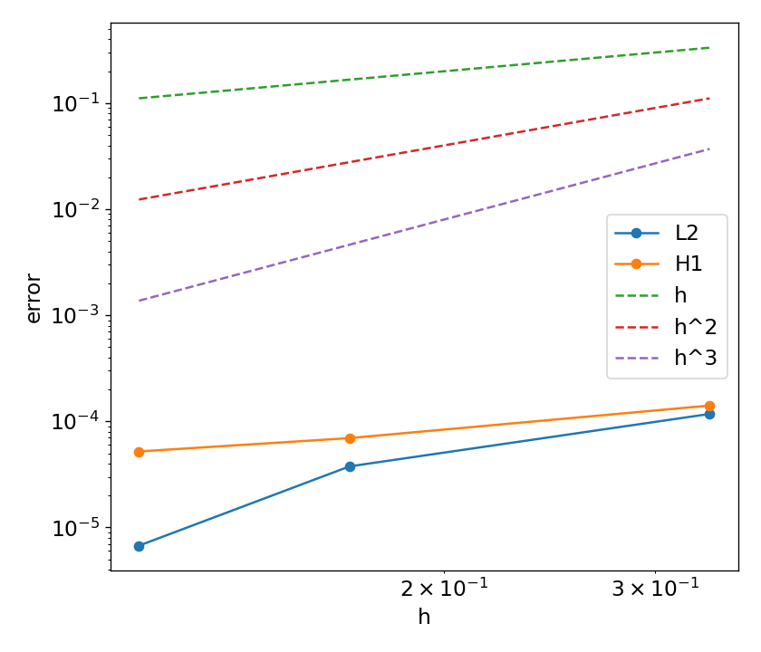
</p>

**ParaView-style visualization**, produced two ways: directly in ParaView from the `.pvtu` output
(left pair), and scripted end-to-end in `pyvista` — including deriving $\nabla u_h$ in code the
way ParaView's *Gradient* filter would in the GUI — for a fully reproducible pipeline (right):

<p align="center">
  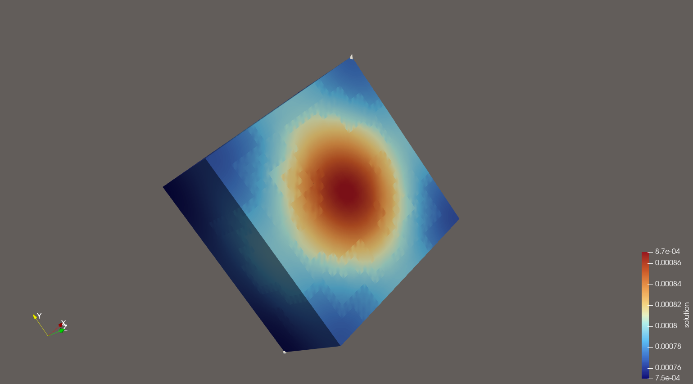
  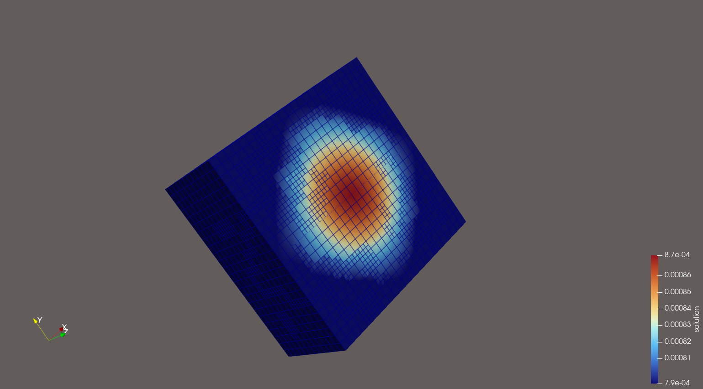
  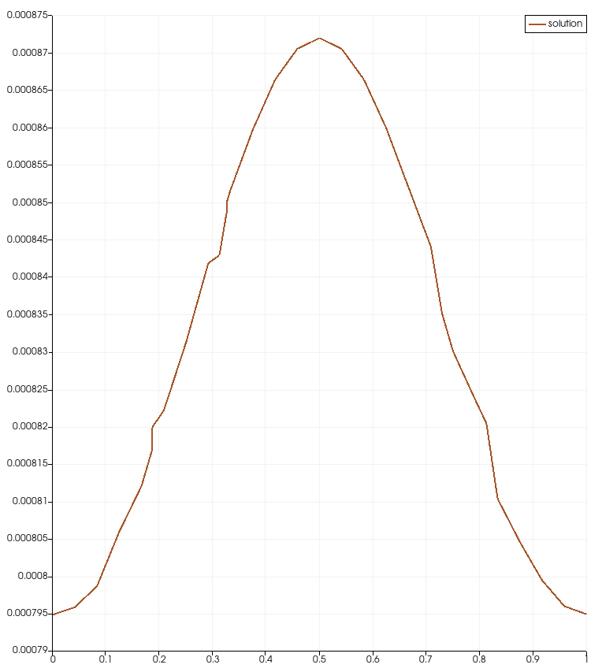
</p>
<p align="center">
  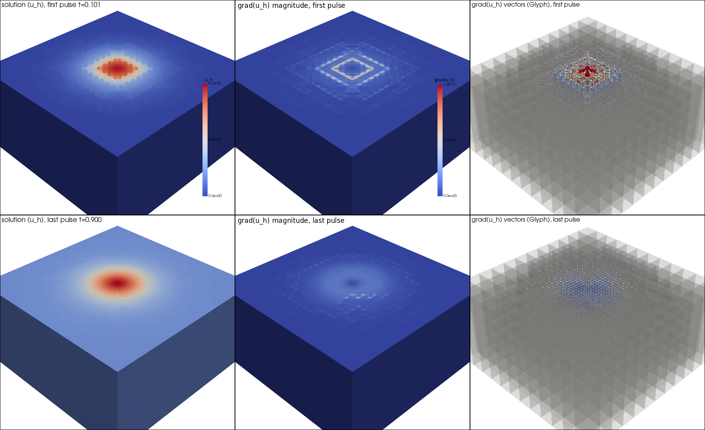
  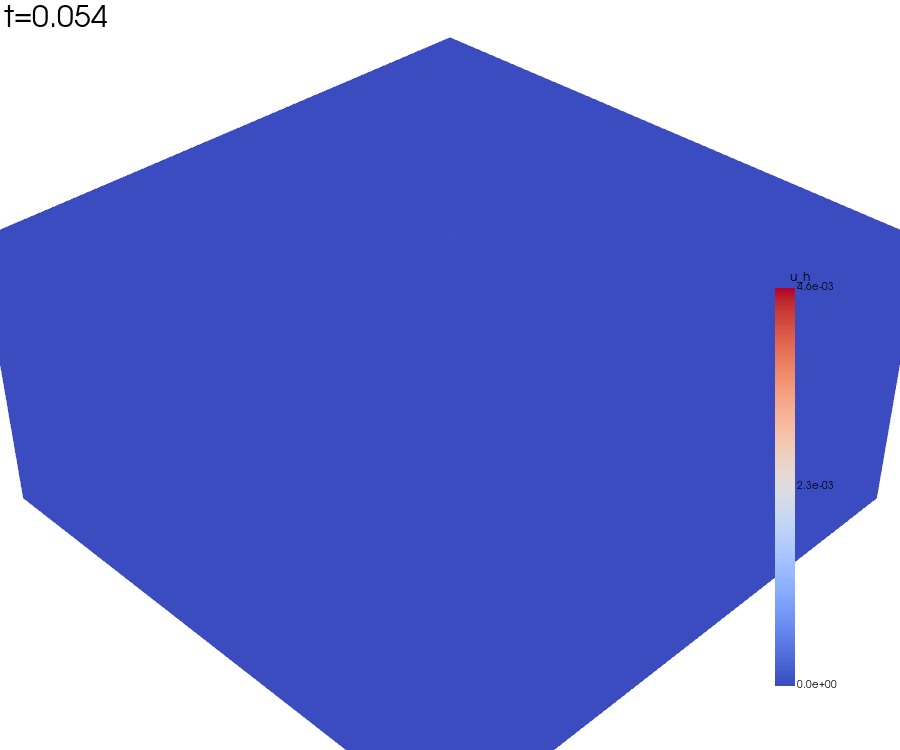
</p>

Full discussion, all quantitative details, the mass-balance/manufactured-solution correctness
checks, and two honestly-reported open issues (a convergence-rate non-monotonicity, and a
mass-balance tolerance regression from tightening the time-adaptivity thresholds) are in the
[report](docs/report.pdf).

## Installation and usage (Docker)

This project is built and tested inside the course-provided container,
`quay.io/pjbaioni/amsc_mk:2025`, which bundles deal.II, Trilinos, MPI, and p4est.

```bash
docker run -it --rm -v "$(pwd)":/work -w /work quay.io/pjbaioni/amsc_mk:2025
```

Inside the container, load the toolchain modules once per shell:

```bash
source /u/sw/etc/profile.d/mk.sh
module load gcc-glibc dealii
```

### Compiling

```bash
mkdir build && cd build
cmake -DCMAKE_BUILD_TYPE=Release ..
make
```

This produces two executables in `build/`: `space-time-adaptivity` (the main solver) and
`manufactured-solution-test` (the correctness check).

### Running

`space-time-adaptivity` is configured through a deal.II `ParameterHandler` `.prm` file rather than
command-line flags. Running it with no argument writes a default template
(`space-time-adaptivity.prm`) and runs with default parameters:

```bash
./space-time-adaptivity
```

To customize, edit (or write) a `.prm` file and pass it as the only argument:

```
set mode         = adaptive       # adaptive | nonadaptive
set run          = default        # default  | convergence
set n_elements   = 12
set degree       = 1
set T            = 1.0
set theta        = 1.0            # 1 = Backward Euler, 0.5 = Crank-Nicolson
set delta_t      = 1e-3
set tol_time_max = 1e-4
set tol_time_min = 2e-6
set dt_max       = 0.01
set n_el_list    = 3,6,9,12       # only used when run = convergence
```

```bash
./space-time-adaptivity my.prm
```

- `mode = adaptive` uses AMR + adaptive $\Delta t$; `mode = nonadaptive` runs a single fixed mesh
  and fixed $\Delta t$ for the whole simulation, for direct comparison (see the results above).
- `run = default` performs one run at `n_elements`; `run = convergence` is slow — it treats the
  largest entry of `n_el_list` as a reference solution and sweeps the rest against it, writing
  `convergence-<adaptive|nonadaptive>.csv`.
- Output files are named `output-n<N>-<adaptive|nonadaptive>_<step>.pvtu`,
  `mass_balance-n<N>-<adaptive|nonadaptive>.csv`, so different mesh sizes and modes never collide.

To run in parallel with MPI:

```bash
mpirun -np 4 ./space-time-adaptivity my.prm
```

### Testing

```bash
cd build
ctest --output-on-failure
```

Runs `space-time-adaptivity` (default mode), the mass-balance `model_validation` check, and
`manufactured-solution-test` (both adaptive and non-adaptive cases). Additional scripts under
`scripts/` (`run_model_validation.sh`, `run_scalability.sh`, `run_verification.sh`,
`run_performance_tests.sh`) drive the same checks in CI (see `.github/workflows/`).

### Visualizing results

Open any `output-n<N>-<mode>_*.pvtu` series in ParaView, or run
[`scripts/notebook.ipynb`](scripts/notebook.ipynb) (`pip install numpy pandas matplotlib pyvista
jupyter`) for every figure above plus the `pyvista`-scripted ParaView-style render and a pulse
animation GIF.

## Organizing the source code

Please place all your sources into the `src` folder.

Binary files must not be uploaded to the repository (including executables). Mesh files should
not be uploaded either — this project generates its mesh programmatically
(`GridGenerator::subdivided_hyper_cube`), so no `.msh`/`gmsh` script is needed.
